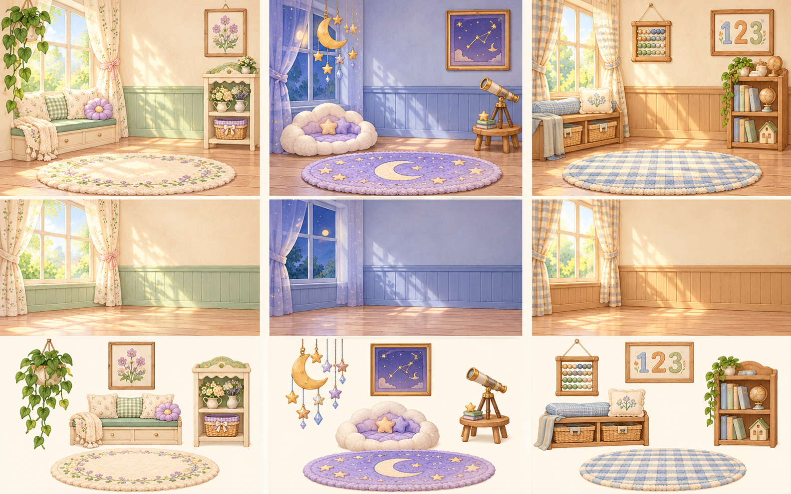

# 房间主题设计提案

状态：视觉方案，尚未替换应用资源或修改购买、存档规则。

从左到右：春日花园、星空梦境、暖木学习屋。从上到下：完整搭配、独立背景、独立装饰预览。

## 组合方式

每套主题提供一张不含可购买摆件的背景，以及五件独立装饰。背景可单独解锁，装饰可分别解锁和摆放，不要求整套购买。

装饰保存自身的固定位置、尺寸与绘制层级。更换背景时不修改已摆放装饰；跨主题摆放时仍使用装饰自身的坐标。允许不协调、重叠或有趣的混搭，不做主题匹配检查或自动挪位。

## 坐标与显示

统一设计画布为 1600 × 1000（16:10），坐标原点为左上角。下表的 x、y 是装饰图片中心的百分比；宽度为画布宽度的百分比，高度按图片比例计算。导出透明 PNG 时应紧贴物体边界，避免透明留白改变视觉位置。

背景、装饰和宠物放在同一画布内整体等比缩放。窄屏保留完整画布，避免背景单独 cover 裁切而装饰按另一套比例定位。

层级：背景 0；挂件、墙饰 10；地毯 20；侧边家具 30；宠物 40。装饰自身包含接触阴影，便于跨主题使用。中央区域约 x=35–65%、y=40–88% 留给宠物。

同层装饰用稳定顺序绘制，跨主题混搭不改变坐标。是否允许重复摆放同一商品，以及商店定价，留待方案确认后决定。

## 春日花园

薄荷绿墙裙、奶油色墙面、浅木地板，左侧窗外是春日花园。暖光和轻柔窗影属于背景，植物和家具不烘焙进背景。

| 装饰 | 中心 x | 中心 y | 宽度 | 层级 |
| --- | --- | --- | --- | --- |
| 垂叶吊盆 | 17% | 22% | 16% | 10 |
| 小花挂画 | 79% | 23% | 17% | 10 |
| 碎花窗边长凳 | 17% | 61% | 29% | 30 |
| 花朵展示柜 | 87% | 57% | 21% | 30 |
| 奶油花边地毯 | 50% | 81% | 63% | 20 |

## 星空梦境

浅紫蓝墙面、柔和深蓝窗景和淡金月光，保留温暖明亮的儿童房感觉。星星纹样可作为墙纸的一部分，月亮挂件和星座画独立出售。

| 装饰 | 中心 x | 中心 y | 宽度 | 层级 |
| 月亮星星吊饰 | 19% | 22% | 18% | 10 |
| 星座挂画 | 78% | 24% | 20% | 10 |
| 云朵宠物床 | 17% | 67% | 28% | 30 |
| 小望远镜与矮支架 | 86% | 64% | 19% | 30 |
| 淡紫星星地毯 | 50% | 81% | 63% | 20 |

## 暖木学习屋

蜂蜜色木墙裙、米白墙面、浅木地板，窗外晴朗，配少量灰蓝色。没有人形桌椅，家具保持小动物房间的低矮比例。

| 装饰 | 中心 x | 中心 y | 宽度 | 层级 |
| 木珠算盘挂饰 | 19% | 24% | 18% | 10 |
| 趣味数字挂画 | 79% | 23% | 18% | 10 |
| 藏书小长凳 | 17% | 63% | 28% | 30 |
| 低矮小书柜 | 86% | 59% | 23% | 30 |
| 蓝色格纹地毯 | 50% | 81% | 63% | 20 |

## 制作边界

视觉概念图用于讨论风格和分层，不是可直接上线的透明资源图集。确认后应分别制作三张干净背景、十五张透明装饰，再按统一坐标合成验证。

已购买衣服的迁移（换购房间装饰或退还积分）、默认开放的背景、具体价格仍待讨论；本提案不改动现有存档。
